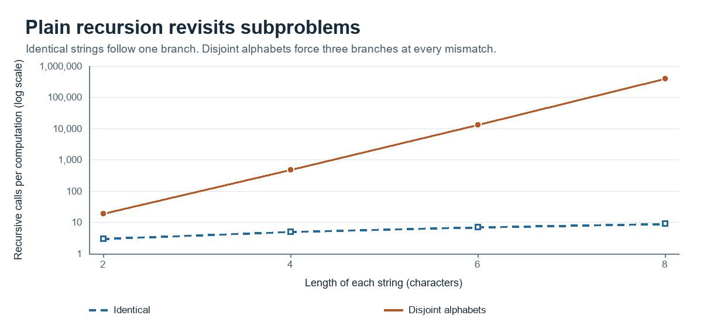
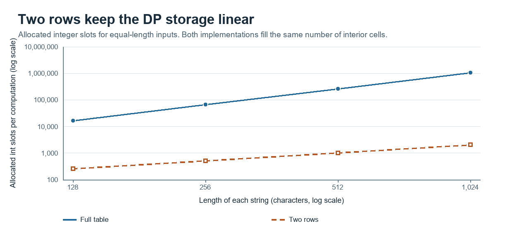
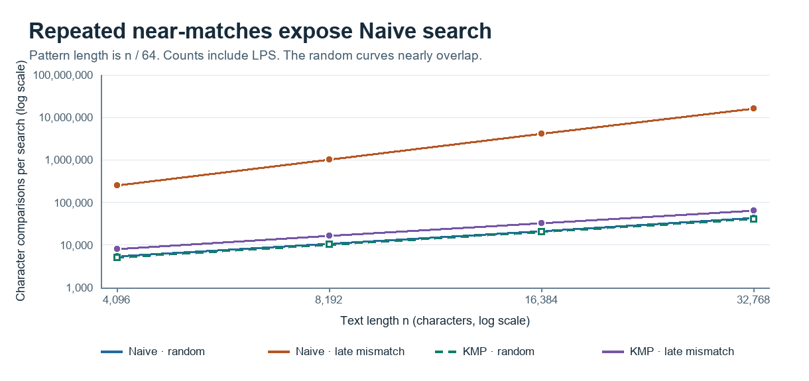

# Assignment 4 — Dynamic Programming and String Algorithms

Nursultan Malgazhdar · SE2516

## Experiment Design Card

| Field | Edit Distance | String search |
| --- | --- | --- |
| Question | How much repeated work does plain recursion perform, and how much storage do two rows save? | How do Naive and KMP scale on random text and on repeated near-matches? |
| Sizes | Both strings have length `n`. Recursion uses 2, 4, 6, 8 to keep the disjoint case feasible. Both DP versions use 128, 256, 512, 1024 to reveal the storage and work trends. | Text lengths 4,096, 8,192, 16,384, 32,768. Pattern length `m = n / 64` grows with the text to expose the worst-case growth of Naive. |
| Inputs | A seeded random string paired with itself, and two seeded random strings over disjoint alphabets. The second input forces all three recursive branches at every non-base call. | A seeded random text and pattern over four symbols, with one copy of the pattern planted in the text. The adversarial text is all `A`, with a pattern of `m-1` copies of `A` followed by `B`, so every Naive alignment fails at the last symbol. |
| Metrics | Recursive calls reveal repeated work. Character comparisons and DP cells track processing. Allocated integer slots compare DP storage. Record median milliseconds per call over five measured trials. | Count text comparisons and LPS comparisons separately and add them for the end-to-end comparison. Record median milliseconds per call over five measured trials. |
| Prediction | The identical pair takes a diagonal recursive path. The disjoint pair grows exponentially. DP fills `n²` interior cells on either input. The full table stores `(n+1)²` integers, while two rows store `2(n+1)`. | Random inputs usually fail early, so both methods are near linear in comparisons. Repeated near-matches make Naive comparisons quadratic as `m` grows with `n`; KMP stays linear. |
| Plots | Calls versus length on a log scale. Allocated integer slots versus length for both DP variants, also on a log scale. | Total comparisons versus text length on a log scale, showing both input types for Naive and KMP. |

The generator uses the fixed seed `42`. Warm up each case with three batches before recording five batches. Batch sizes are fixed by case to reduce clock noise on short calls. Each CSV row represents one measured batch and reports the mean time and exact counters per algorithm call. The report uses the median of the five recorded times.

## Results and figures

The run used Eclipse Temurin 21 on Windows. The 200 CSV rows cover 40 algorithm, input and size combinations. DP storage counts allocated integer slots in the arrays, excluding object headers and stack frames. Search comparisons include KMP preprocessing, which is done once per search call.

Figure 1. At length 8, recursion made 398,593 calls on disjoint inputs and 9 calls on identical inputs.

Figure 2. At length 1,024, the full table used 1,050,625 integer slots and two rows used 2,050, a 512.5-fold reduction.

Figure 3. As text and pattern lengths increased eightfold, comparisons on repeated near-matches grew almost 64-fold for Naive and eightfold for KMP.

## Prediction versus result

**Edit Distance.** On identical inputs, the recursive method followed only the diagonal and made `n + 1` calls. On disjoint inputs, calls grew from 19 at length 2 to 398,593 at length 8. Both DP variants filled 1,048,576 interior cells at length 1,024 on either input. The different growth of the two buffer sizes confirms the memory prediction.

**String search.** At length 32,768, Naive used 43,434 comparisons on random text and 16,515,584 on repeated near-matches. KMP used 41,388 and 66,046 respectively, including LPS. This matches the prediction. The random curves were close because most Naive alignments failed early, and KMP's advantage became large when the same prefix appeared at almost every start position.

## Short answers

**Which input made string search slowest?** The all-`A` text and the pattern ending in `B` produced the slowest Naive case in this experiment. Each alignment matched the first `m - 1` symbols and failed on the last one. Naive then tried the next position from scratch, making `(n - m + 1) × m` comparisons.

**How large an input could recursive Edit Distance handle?** The largest measured disjoint pair had length 8 per string and took a median of 2.264 ms. The call count grew nearly 30-fold from length 6 to 8 because each mismatch generated three recursive branches. That growth motivated the cap at 8 so repeated runs stayed short. The experiment measured the chosen range, so it does not establish a hard size limit.

**What do two rows gain and lose?** Two rows reduce the extra buffer from `O(nm)` to `O(m)` while preserving the distance. Both methods still fill `nm` interior cells. With only two rows, a direct walk backwards through the whole table to recover an edit sequence is unavailable because earlier rows have been overwritten.

**Which search would I use for the city platform?** I would use KMP for long log files because it avoids restarting the comparison after repeated prefixes and has linear worst-case time in the text and pattern lengths. On the largest late-mismatch case, it did about 250 times fewer comparisons than Naive. The random results show that the advantage depends on input type, but repetitive log messages make predictable behavior valuable.

**Measured time.** For the largest late-mismatch case, the medians were 47.172 ms for Naive and 0.396 ms for KMP. At the largest disjoint DP size, they were 10.337 ms for the full table and 7.703 ms for two rows. Timing did not always grow monotonically, for example on small random KMP inputs, where JVM compilation and measurement noise can matter. Operation counts give reproducible evidence of the growth trends across sizes.
